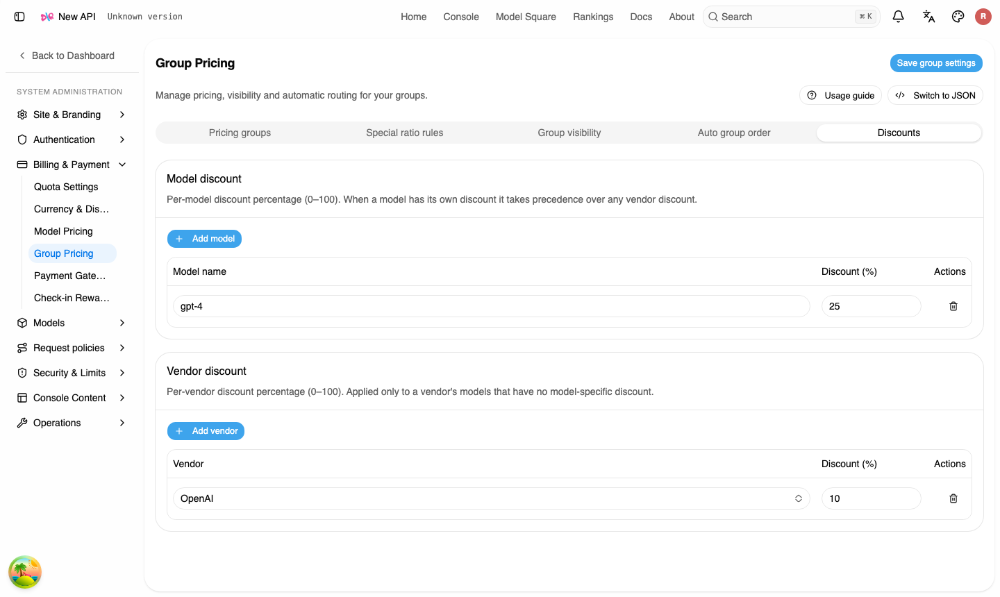
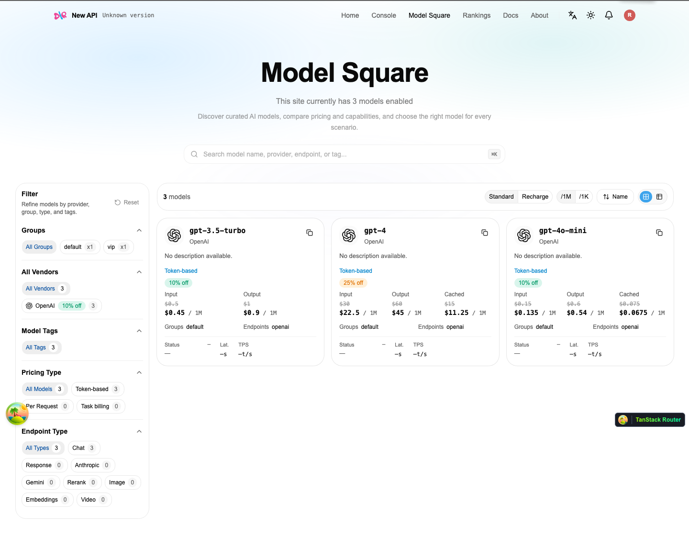

# 모델 / 벤더 할인 — 관리자 사용 가이드

> 이 문서는 **관리자**가 모델·벤더 할인을 어떻게 이해하고, 어디서 설정하고, 어디서 확인하는지 설명합니다.
> 기술 설계는 [design.md](./design.md) 참고. 화면 라벨은 영문 UI 그대로 적었습니다.

---

## 1. 개념 한눈에

| 항목 | 설명 |
|---|---|
| **모델 할인 (Model discount)** | 특정 **모델** 1개에 X% 할인 |
| **벤더 할인 (Vendor discount)** | 특정 **벤더(provider)** 의 모델 전체에 X% 할인 |
| **우선순위** | 모델 할인이 있으면 모델 할인, 없으면 그 모델의 벤더 할인, 둘 다 없으면 할인 없음 (**모델 > 벤더 > 없음**). 요청 모델명과 과금 모델명이 다르면 요청 모델명을 먼저 본다(§4) |
| **값** | 할인율 **%**(0~100). 100%면 무료 |
| **적용 범위** | **전역**(모든 사용자·모든 그룹). 그룹 배율(Group Ratio)과 **곱연산**으로 함께 적용 |
| **정가 영향** | 정가(ModelRatio/ModelPrice)는 그대로. 할인은 별도 레이어라 자유롭게 켜고 끔 |

> 예) `gpt-4`에 모델 할인 30%가 있고 OpenAI 벤더 할인 10%가 있으면 → `gpt-4`는 **30%**(모델 우선). OpenAI의 다른 모델(개별 할인 없음)은 **10%**(벤더).

---

## 2. 어디서 설정하나

**경로:** 시스템 설정(System Administration) → 결제(**Billing & Payment**) → 그룹 가격(**Group Pricing**) → **Discounts** 탭
(URL `/system-settings/billing/group-pricing`)



Discounts 탭에는 카드 두 개가 있습니다.

### Model discount (모델 할인)
- 설명: *Per-model discount percentage (0–100). When a model has its own discount it takes precedence over any vendor discount.*
- **Add model** 버튼 → 행 추가(`model_1` / `0`으로 채워짐) → **Model name**과 **Discount (%)** 입력
  - 모델명은 가격 페이지에 보이는 모델명과 똑같이 입력(예: `gpt-4`, `Qwen/Qwen3.6-27B-FP8`)
- 휴지통 아이콘으로 행 삭제

### Vendor discount (벤더 할인)
- 설명: *Per-vendor discount percentage (0–100). Applied only to a vendor's models that have no model-specific discount.*
- **Add vendor** 버튼 → 벤더 선택(등록된 벤더 목록 드롭다운, 아직 쓰지 않은 첫 벤더가 미리 선택됨) + **Discount (%)** 입력
  - 벤더 목록을 불러오지 못하거나 벤더가 하나도 없으면 벤더 이름을 직접 입력하는 칸이 나옵니다.

### 저장 / JSON 모드
- 오른쪽 위 **Save group settings** 버튼으로 저장합니다(이 페이지의 그룹 설정과 함께 저장되며, 바뀐 키만 `PUT /api/option/`으로 보냅니다).
- 오른쪽 위 **Switch to JSON** 을 누르면 페이지 전체가 JSON 모드가 되고, 그룹 필드들과 함께 `Model discount`·`Vendor discount` 두 필드가 나옵니다:
  - Model discount: `{ "gpt-4": 25 }`
  - Vendor discount: `{ "OpenAI": 10 }`
- 0~100 범위를 벗어나거나 숫자가 아닌 값이 있으면 `Discount percentages must be between 0 and 100.`가 표시되고 저장되지 않습니다(저장을 누르면 Discounts 탭이 열림). 서버도 같은 값을 거부하고 이전 값을 유지합니다.
- 이름이 빈 행은 `Rows with an empty name are not saved` 경고가 뜨고 저장에서 빠집니다.
- 같은 이름이 두 번 있으면 `Duplicate model names: …` / `Duplicate vendor names: …` 경고가 뜹니다. 저장은 막지 않으며 마지막 행의 값이 남습니다.
- 저장되지 않는 행(이름이 빈 행 등)은 Visual ↔ JSON 전환 때 편집기가 다시 그려지면서 사라집니다.

> 저장하면 가격 캐시가 즉시 무효화되어 마켓플레이스와 과금에 곧바로 반영됩니다.

---

## 3. 어디서 확인하나

### (1) 모델 마켓플레이스 (Model Square / 가격 페이지)

**경로:** 상단 메뉴 **Model Square** (URL `/pricing`)



- **벤더 필터(All Vendors)**: 할인이 있는 벤더 칩에 `10% off` 배지. 벤더 자신의 할인율이며, 그 벤더의 모델 하나에 걸린 모델 할인은 여기 나오지 않습니다.
- **모델 카드**: 입력/출력/캐시 가격이 `~~정가~~`(위 줄) + 할인가(아래 줄)로 표시되고, 과금 방식 캡션(**Token-based**) 아래에 `X% off` 배지.
- **표 보기**: Price 열은 취소선 정가 + 할인가와 배지, Cached 열은 할인가만(취소선 없음).
- **할인율별 색상(히트맵)** — 높을수록 눈에 띔:
  - 1–14% 에메랄드 / 15–29% 앰버 / 30–49% 오렌지 / 50%+ 빨강
- 동적가격(billingexpr) 모델은 고정가가 없어 **배지만** 표시되고, 화면의 계산 가격은 정가 그대로입니다(실제 과금에는 할인이 적용됨).
- 모델 상세(`ModelDetails`)의 기본가·그룹별 가격표에도 할인가와 배지가 들어 있지만, 현재 upstream 화면에서는 상세 화면으로 가는 경로가 없습니다(`/pricing/$modelId`는 `/pricing`으로 돌아감).

### (2) 사용 로그 — 상세의 Billing Details

**경로:** 사용 로그(**Usage Logs**, `/usage-logs/common`) → 로그 행의 상세 버튼 → **Log Details** 창의 **Billing Details**

할인이 그룹 배율과 **분리**되어 한 행으로 표시됩니다:

```
Billing Mode     Per-token
Input            $30/M
Output           $60/M
Group Ratio      1.0000x
Model discount   0.7500x
```

- 모델 할인이 적용된 요청 → `Model discount 0.7500x`
- 벤더 할인이 적용된 요청 → `Vendor discount 0.9000x`
- 100% 할인 → `Model discount 0.0000x`(과금 0, `Group Ratio`는 할인 전 기저값 그대로)
- 할인이 없으면 할인 행이 없습니다. `Input`/`Output` 단가는 정가이고, 청구액은 로그의 비용(quota) 그대로입니다.
- 조직 사용 로그(`/organization/usage-logs/common`)의 상세도 같은 행을 보여 줍니다.

> 이 분리 표기는 **할인 기능이 들어간 뒤의 새 로그부터** 적용됩니다.
> 텍스트·Claude·Realtime(WSS)·오디오 로그에 표시됩니다. Midjourney·비동기 작업(task) 로그는 할인이 그룹 배율에 접힌 값으로만 남고 할인 행이 없습니다.

---

## 4. 동작 규칙 / 주의

- **모델 > 벤더 > 없음**: 한 요청에는 둘 중 하나만 적용됩니다(동시 적용 아님).
- **요청 모델명 우선**: 요청한 모델명(origin)과 과금에 쓰는 모델명(billing)이 다를 수 있습니다(예: `claude-sonnet-4-5-thinking` 요청이 `claude-sonnet-4-5`로 과금). 조회 순서는 **요청 모델의 모델 할인 → 요청 모델의 벤더 할인 → 과금 모델의 모델 할인 → 과금 모델의 벤더 할인**이고, 처음 찾은 값 하나만 씁니다. 마켓플레이스가 요청 모델명으로 할인을 보여 주므로, 보이는 할인과 청구되는 할인이 같습니다.
  - 주의: 기본 이름(`claude-sonnet-4-5`)에만 할인을 걸면, 자기 할인이 없는 변형(`…-thinking`)도 과금 모델명으로 내려가 같은 할인을 받습니다. 변형을 정가로 두려면 변형 이름에 `0`을 넣으세요(0%도 "설정된 값"이라 조회가 거기서 멈춥니다).
- **그룹 배율과 곱연산**: 최종 배수 = `Group Ratio × Discount`. 예) 그룹 0.9 + 모델 할인 30% → 0.9 × 0.7 = 0.63. 로그의 `Group Ratio` 행은 할인 전 0.9를 보여 줍니다.
- **정가는 불변**: 할인을 끄면 원래 단가가 그대로 돌아옵니다(정가를 직접 내리는 것과 다름).
- **벤더명 기준**: 벤더 할인은 벤더 "이름"으로 매칭됩니다. 벤더명을 바꾸면 할인 설정도 다시 맞춰야 합니다.
- **100% 할인**: 허용됩니다(무료). 이 모델의 위반 수수료(violation fee)도 같은 할인을 받아 0이 됩니다. 신중히 사용하세요.
- **100% 할인은 "무료 모델"이 아닙니다**: 과금은 0이지만 무료 모델 판정(`EnableFreeModelPreConsume`이 꺼져 있을 때 사전 차감을 건너뛰는 규칙)은 할인 전 가격으로 합니다. 그래서 결제 세션이 그대로 만들어지고 0을 예약하며, 조직 비활성·구성원 정지 검사도 그대로 적용됩니다(정지된 구성원은 100% 할인 모델도 403 `organization membership is suspended`). 사용 로그에는 `discount_multiplier` 0이 기록됩니다. 모델 가격·배율이나 그룹 배율 자체가 0인 경우만 무료 모델입니다.
- 할인은 사전차감과 정산에 같은 값으로 들어갑니다(채널 재시도 때도 다시 계산되어 한 번만 적용).
- 할인 표시·과금은 rate limit과 무관합니다.

---

## 5. 빠른 시작 예시

1. 시스템 설정 → **Billing & Payment** → **Group Pricing** → **Discounts** 탭 이동
2. **Model discount → Add model** → `gpt-4` / `25` 입력
3. **Vendor discount → Add vendor** → `OpenAI` 선택 / `10` 입력
4. 오른쪽 위 **Save group settings** 클릭
5. **Model Square**(`/pricing`)에서 `gpt-4` 카드에 `25% off`(앰버), OpenAI의 다른 모델과 벤더 칩에 `10% off`(에메랄드) 확인
6. 그 모델로 요청한 뒤 **사용 로그 → Log Details → Billing Details**에서 `Model discount 0.7500x`(gpt-4) / `Vendor discount 0.9000x`(OpenAI의 다른 모델) 확인

> 2026-10-14 단계 C 수동 실행에서 이 순서를 그대로 확인했다(`docs/2026-10-14-rebase-phase-c.md` §6).
